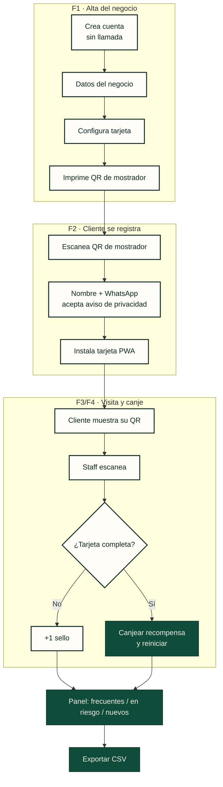

# 01 · Mapa de flujos del MVP (v1, propuesta)

Fase 6, Product Design. Estado: ✅ **Aprobado por Aarón (2026-10-20)**. Fecha: 20 oct 2026.
Siguiente fase: **Fase 7, Desarrollo del MVP + piloto 0**; sale con su criterio (un local real usa el flujo completo una semana sin errores bloqueantes, ≥10 pilotos confirmados por escrito de ≥3 oficios, entrevistas y consulta legal hechas), sin fecha. Piloto: hasta 20 negocios (barberías, estéticas, tapiocas, cafeterías), 30 días de prueba gratis (D-003/D-004/D-006).
> Historial: la meta original de "MVP en producción el 8 nov 2026" ya no rige; el plan va por fases sin calendario.
Diagrama: `mapa-flujos-mvp.png`.

## 1. Actores
- **Dueño del negocio**: da de alta su negocio, configura la tarjeta, ve quién regresa y exporta datos.
- **Staff (mostrador)**: registra visitas y canjes. En el MVP usa la misma cuenta del dueño; los usuarios de staff con permisos van **después**.
- **Cliente final**: se registra con el QR del mostrador, instala su tarjeta (PWA) y junta sellos.

## 2. Confianza desde el día uno (MVP, no negociable)
| Elemento | Dónde vive |
|---|---|
| Alta self-serve, sin llamada de ventas | N1 Registro: cuenta + negocio + tarjeta en minutos, sin tarjeta de crédito durante la prueba |
| Aviso de privacidad claro | C1 Registro del cliente: texto corto visible arriba del botón + enlace al aviso completo; también en el pie del panel |
| Exportar datos de clientes | N7 Clientes → "Exportar CSV", siempre disponible (también al pausar tras la prueba) |
| Soporte por WhatsApp visible | Botón fijo "Ayuda por WhatsApp" en el panel (N*) y en el onboarding |

## Diagrama de flujos núcleo

## 3. Inventario de pantallas
**Panel del negocio (web, responsivo)**
| # | Pantalla | Alcance |
|---|---|---|
| N1 | Registro / Entrar (correo + código **o** contraseña, con restablecimiento de contraseña por correo; D-005, actualizado 2026-10-21). *El wireframe aprobado de la pieza 04 muestra solo código: Diseño de Producto lo ajusta* | MVP |
| N2 | Onboarding: datos del negocio (nombre, oficio, logo) | MVP |
| N3 | Configurar tarjeta: nº de sellos (4–12), recompensa, interruptor de sello de bienvenida (se otorga automático al registrarse), vista previa. *(Alineado con la pieza 04 aprobada: sin color de acento en el MVP.)* | MVP |
| N4 | QR de mostrador: descargar/imprimir cartel | MVP |
| N5 | Mostrador: registrar visita (escáner) + confirmación | MVP |
| N0 | Inicio: resumen semanal (lo primero que ve el dueño al entrar; solo en el panel, no por WhatsApp) | MVP |
| N6 | Quién regresa (frecuentes, en riesgo, nuevos) | MVP |
| N7 | Clientes: tabla, búsqueda, ficha con historial, exportar CSV | MVP |
| N8 | Ajustes: negocio, tarjeta (sello de bienvenida, límite de sellos), plan/prueba, aviso de privacidad, soporte WhatsApp | MVP |
| — | Varias tarjetas, sucursales, usuarios de staff | Después (plan Negocio) |
| — | Avisos, Campañas, Reportes avanzados | Después |
| — | Pago en línea (CFDI, OXXO/SPEI) | Después |

**Tarjeta del cliente (PWA)**
| # | Pantalla | Alcance |
|---|---|---|
| C0 | Mis tarjetas: tarjetas de varios negocios en la misma PWA, con mini aro; tocar abre C3 (ADR-001; diseño ✅ Aprobado 2026-10-20 en pieza 5) | MVP |
| C1 | Registro: nombre + WhatsApp, aceptación de aviso de privacidad | MVP |
| C2 | Instalar en pantalla de inicio (guía iOS/Android) | MVP |
| C3 | Mi tarjeta: aro de sellos, mi QR, recompensa | MVP |
| C4 | Recompensa lista / canjeada | MVP |
| C5 | Mis datos: ver, borrar cuenta | MVP |
| — | Apple / Google Wallet | Después |

## 4. Flujos principales
**F1. Alta del negocio y configurar tarjeta** (meta: < 5 min, sin ayuda)
1. Desde lealtab.com, "Empieza gratis" → N1 crea cuenta; entra con código por correo o con contraseña.
2. N2 datos del negocio → N3 configura tarjeta con vista previa en vivo.
3. N4 descarga el cartel QR de mostrador. Listo: arrancan los 30 días de prueba.

**F2. Cliente se registra e instala la tarjeta**
1. Escanea el QR del mostrador con la cámara → abre la tarjeta web del negocio.
2. C1: nombre + WhatsApp, lee el aviso corto y acepta → crea su tarjeta. Si el negocio activó el sello de bienvenida, se le otorga **automáticamente** al registrarse (queda en 1/N), sin confirmación del staff.
3. Si el cliente ya tiene la app LealTab o una cuenta con su WhatsApp, la nueva tarjeta se agrega a **Mis tarjetas** (C0) y no repite instalación. Si no, C2: invitación a instalarla; si no la instala, se puede recuperar con su WhatsApp.

**F3. Registrar visita en mostrador** — ver recomendación abajo
1. Cliente muestra **su QR** (C3).
2. Staff abre N5 y lo escanea → ve nombre y sellos → confirma "+1 sello".
3. Ambos ven la confirmación; la tarjeta del cliente se actualiza sola.
Respaldo: buscar al cliente por WhatsApp en N5 si la cámara falla.

**F4. Recompensa completada y canje**
1. Al llegar al último sello, C4 muestra "Recompensa lista" (aro completo en durazno).
2. En la siguiente visita el staff escanea → N5 muestra "Canjear recompensa" → confirma.
3. La tarjeta se reinicia; queda el canje en el historial.

**F5a. Resumen semanal** (N0, al entrar)
1. El dueño entra al panel y lo primero que ve es el resumen de la semana: visitas vs. semana anterior, clientes que regresaron, en riesgo, recompensas canjeadas y una acción sugerida.
2. Solo vive en el panel; no se envía por WhatsApp.
3. Evento de analítica `resumen_semanal_visto` (negocio, semana) para medir en el piloto cuántos dueños lo abren cada semana.

**F5. Panel de quién regresa** (N6)
- **Frecuentes**: 2+ visitas en los últimos 30 días.
- **En riesgo**: sin volver en más del doble de su intervalo habitual (mínimo 30 días).
- **Nuevos**: primera visita en los últimos 30 días.
- Cifras clave: clientes que regresan, recompensas canjeadas. Cada grupo abre la lista en N7.

**F6. Exportar datos**: N7 → "Exportar CSV" (nombre, WhatsApp, visitas, sellos, última visita). Disponible también con la cuenta en pausa.

## 5. Registrar visita: ¿quién escanea a quién?
| Opción | A favor | En contra |
|---|---|---|
| **A. El negocio escanea el QR del cliente (recomendada)** | Cada sello lo confirma una persona: sin trampas. El cliente no necesita hacer nada más que abrir su tarjeta. Funciona igual con la tarjeta instalada o en el navegador | El staff necesita un teléfono/tablet con cámara en el mostrador |
| B. El cliente escanea un QR fijo del negocio | Cero equipo para el negocio | Fácil de hacer trampa (foto del QR); requiere QR rotativo o geolocalización, más complejo para el MVP |
| C. El cliente escanea un QR dinámico en la pantalla del negocio | Seguro | Requiere pantalla encendida en el mostrador; más fricción |

**Recomendación: A**, con búsqueda por WhatsApp como respaldo. El QR fijo del mostrador se usa solo para registrarse (F2), no para sumar sellos.

## 6. Decisiones aprobadas (2026-10-20)
1. **Registro de visitas**: opción A, el negocio escanea el QR del cliente; búsqueda por WhatsApp como respaldo.
2. **Sello de bienvenida**: interruptor en N3 Configurar tarjeta (el negocio lo activa o desactiva). Si está activo, se otorga **automáticamente al registrarse en C1; reemplaza la confirmación del staff** (cambio de Aarón, 2026-10-20).
3. **En riesgo**: sin volver en más del doble de su intervalo habitual, mínimo 30 días.
4. **Staff**: una sola cuenta compartida por negocio en el MVP.
5. **"Hecho con LealTab" siempre visible** (Aarón, 2026-10-20): en todos los planes, Pro incluido, en la tarjeta del cliente y en el cartel de mostrador. Resuelve la decisión abierta; se elimina la variante sin leyenda.
6. **Resumen semanal** (Aarón vía PM, 2026-10-20): entra al MVP, solo dentro del panel web (no por WhatsApp), y es lo primero que ve el dueño al entrar (pantalla Inicio, N0). El piloto mide cuántos dueños lo abren cada semana con el evento `resumen_semanal_visto`.
7. **Una sola PWA LealTab con Mis tarjetas** (ADR-001, 2026-10-20): un cliente tiene las tarjetas de varios negocios en la misma app (C0), en el MVP. La cuenta del cliente se identifica por su WhatsApp.
8. **Límite de sellos y antiabuso** (Aarón vía PM, 2026-10-20; ver `investigacion-limite-sellos.md`): el QR personal del cliente rota periódicamente. Por defecto, **1 sello por cliente por día**, se reinicia a medianoche en la zona horaria del negocio. En N8 Ajustes el negocio puede cambiarlo a *1 cada X horas* (X libre; 2 h es solo una sugerencia; aclarado 2026-10-21) o *Sin límite* (con advertencia). Siempre hay un bloqueo fijo de 2 min contra doble escaneo (D-014, 2026-10-21). N5 muestra "Ya recibió su sello hoy" (o "Próximo sello disponible a las HH:MM"). Se registra quién dio cada sello y cuándo, visible en el historial de N7. Reemplaza la regla de 10 minutos propuesta en la pieza 6.
9. **Offline-first** (Aarón, 2026-10-20): mostrador y tarjeta funcionan sin conexión. Cola local en IndexedDB (UUID de idempotencia, hora y id del dispositivo, firma), QR rotativo con HMAC por pasos de 60 s validable sin conexión (gracia de 10 min), chequeo local de límite y doble escaneo, sincronización en segundo plano donde el servidor revalida y es la fuente de verdad; rechazos a Clientes → Por revisar. Detalle en `06-estados-error-y-vacio.md`. **Canje sin conexión: permitido con límite** (aprobado 2026-10-20): solo si la tarjeta está completa en caché sincronizada en las últimas 24 h y máximo 1 canje por tarjeta mientras dure el modo sin conexión; un doble canje va a Por revisar.
10. **Pieza 6**: "Activar mi plan" abre WhatsApp; el código de acceso del dueño dura 10 min (aprobado 2026-10-20).

Siguiente: pieza 2, `02-tarjeta-cliente.md`.
